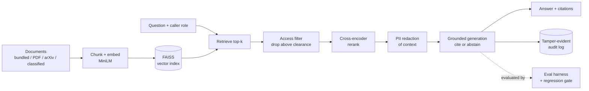

# grounded-rag

A retrieval-augmented QA system that cites its sources, declines to answer when the documents don't support it, and governs the answer for regulated settings. It ships with an evaluation harness, a regression gate, access-scoped retrieval, PII redaction, and a tamper-evident audit trail.

Live demo: https://grounded-rag-pushkar.streamlit.app · Built by [Pushkar Awate](https://pushkar-awate.github.io)

Ask questions over a bundled set of ML and LLM explainers, your own uploaded PDF, a live arXiv search, or a synthetic classified corpus that demonstrates access control. Each answer is grounded in the passages that were retrieved and carries `[n]` citations back to the chunks it used. When the corpus cannot answer, the app abstains instead of guessing. When the caller is not cleared to see the passages that would answer, it abstains rather than answering from data the caller cannot access. Every decision is written to a hash-chained audit log.

## The idea

Most RAG demos answer anything, including questions their corpus cannot support, and they rarely show whether an answer is backed by a source. A former Chief Data Officer put the gap well: controlling who can see a document is only half the problem. The other half is whether the model refuses to answer instead of confidently filling the gap. You have to govern the output, not just the access. This project is built around that idea and measures it directly.

The headline number is the false-answer rate: how often the system answers a question it should have refused. Turning the grounding gate off (a naive RAG that always answers from the best-matching passage) sends that rate to 100% on the unanswerable set. Turning it on brings it down, and the gap is the whole point.

## What it does

Abstention is measured, not assumed. The scorecard treats abstain-or-answer as a classification problem and reports precision, recall, the false-answer rate (answered when it should not have, the dangerous failure), and the over-refusal rate (refused when it could answer, the annoying one). The gold set includes adversarial traps: out-of-corpus questions, in-corpus distractors that ask for a specific fact the documents never state, and false-premise questions.

Access-scoped retrieval filters passages above the caller's clearance before rerank and generation, so a passage the caller cannot see never reaches the model. It uses an ordered classification lattice (Public, Internal, Confidential, Restricted) with optional need-to-know compartments. When access filtering removes the only passages that would answer, the system abstains, and the audit record says the abstention was caused by access control rather than by a missing answer.

Every answer-or-abstain decision is written to an append-only audit log whose records are hash-chained, so editing, removing, or reordering any record is detectable. This is the operational-risk evidence a reviewer asks for under a standard like APRA CPS 230.

Retrieval runs in two stages: a fast bi-encoder (MiniLM with FAISS) pulls candidate chunks, then a cross-encoder reranker reads the question and each candidate together and reorders them. Generation is provider-agnostic through a `Brain` interface, so the tests and CI run with no API key and no cost, while the live app uses Groq.

## Architecture



The app, the CLI, and the evaluation harness all run the same `RagPipeline`, so an evaluation number describes the same code path a user hits. Governance is opt-in: with no role, no PII flag, and no audit log, the pipeline behaves as a plain grounded RAG system.

## Results (committed deterministic baseline)

A 23-case gold set: 9 answerable, 14 unanswerable (4 plain, 10 adversarial). These numbers come from the deterministic offline stack that runs in CI, so anyone can reproduce them with `python run.py --fake-embed`.

| Metric | Score |
|--------|------:|
| Retrieval hit-rate | 100% |
| MRR (mean) | 0.87 |
| Groundedness | 100% |
| Citation coverage | 100% |
| Abstention precision | 100% |
| Abstention recall | 57% |
| False-answer rate | 43% |
| Over-refusal rate | 0% |

Grounded vs ungrounded, on the 14 unanswerable questions: the naive RAG answers 100% of them; the grounded system drops that to 43%, a 57-point reduction, with zero over-refusals (it never refuses a question it can answer).

The honest reading of the 43%: the deterministic offline answerer catches every out-of-corpus trap (4 of 4) but is fooled by in-corpus distractor and false-premise traps, because it scores passages on term overlap and cannot tell that a specific fact is absent or that a premise is false. That is exactly the case the real LLM, instructed to answer only from the sources, is there to handle, and the live app runs that stack. The deterministic number is the reproducible floor the gate protects, not the ceiling.

Access-scoped retrieval: 20 of 20 (question x role) trials correctly scoped, with zero clearance violations. A public user is refused the confidential risk register and the restricted incident report; a risk officer is refused the finance-compartment figures; only the executive role sees everything. Reproduce with `python run.py --fake-embed --access`.

## Two tiers of evaluation

| Tier | Embedder / Reranker / Generator | Where it runs | Purpose |
|------|----------------------------------|---------------|---------|
| Deterministic | Hashing + identity + `ExtractiveBrain` | CI and committed `baseline.json` | Reproducible, offline, zero-cost guard on the logic |
| Live | MiniLM + cross-encoder + Groq GPT-OSS-20B | Streamlit Cloud | Real retrieval and generation quality |

CI never downloads a model or spends a token, but it still fails a pull request that breaks grounding, refusal, abstention precision or recall, or that lets a single passage leak across a clearance boundary.

## Quickstart

```bash
pip install -r requirements.txt          # live stack
streamlit run streamlit_app.py           # open the app

# or just the evaluation (deterministic, no key, no downloads):
pip install -r requirements-dev.txt
python run.py                            # scorecard with abstention metrics
python run.py --gate                     # fail on a regression vs the baseline
python run.py --compare                  # grounded vs ungrounded false-answer rate
python run.py --access                   # access-scoped retrieval across roles
python run.py --llm                      # use Groq for generation and the faithfulness judge
```

Set `GROQ_API_KEY` (an environment variable or `.streamlit/secrets.toml`) to turn on LLM generation. Without it the deterministic extractive answerer runs and the app still works end to end.

## Tech

Python, sentence-transformers (MiniLM), FAISS, cross-encoder reranking, Groq (GPT-OSS-20B), Streamlit, GitHub Actions. No paid services: local embeddings, a local vector index, a free LLM tier, and free hosting.

## Layout

```
ragcore/     ingest, embed, store, rerank, generate, pipeline, brain
govcore/     access-scoped retrieval, tamper-evident audit log, PII redaction
evalcore/    dataset, judges, runner, metrics, gate, compare, access_eval
app/         corpus loaders (bundled / arXiv / classified)
data/        sample corpus, classified corpus, gold eval set, access cases
tests/       deterministic pytest suite
run.py       eval CLI (scorecard / gate / compare / access / baseline)
streamlit_app.py
```

Part of a set of reliability-focused AI/ML projects. See also [agenteval](https://github.com/pushkar-awate/agenteval) (evaluation and a regression gate for agents) and [selfheal-mlops](https://github.com/pushkar-awate/selfheal-mlops) (drift-triggered retraining).
