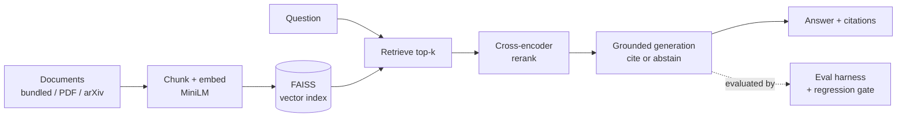

# grounded-rag

**A retrieval-augmented QA system that cites its sources and refuses to answer when the documents don't support it — shipped with an evaluation harness and a regression gate.**

> Live demo: _deploying…_ · Built by [Pushkar Awate](https://pushkar-awate.github.io)

Most RAG demos happily hallucinate: ask them something outside their corpus and they invent a confident, uncited answer. `grounded-rag` is built around the opposite principle — **an answer you can't trace to a source is a bug** — and it measures that property instead of just asserting it.

Ask questions over a bundled set of ML/LLM explainers, your own uploaded PDF, or a live arXiv search. Every answer is grounded in retrieved passages with `[n]` citations. When the corpus can't answer, the system **abstains**. A one-click evaluation reports retrieval quality, groundedness and correct-refusal rates, and gates them against a committed baseline — the same gate that runs in CI.

---

## What makes it different

- **Abstention is a first-class, measured behaviour.** The gold eval set deliberately includes unanswerable questions; a model that answers them fails the `refusal_correct` judge. Refusing to guess is scored, not hoped for.
- **Two-stage retrieval.** Fast bi-encoder search (MiniLM + FAISS) narrows the field; a cross-encoder reranker then reads the question and each candidate *together* for accurate relevance — the single biggest quality lever in practical RAG.
- **Every claim is cited** back to the exact chunk it came from, with provenance preserved from ingestion onward.
- **An evaluation harness, not vibes.** Retrieval hit-rate, MRR, groundedness, citation presence and correct-refusal — plus an optional LLM faithfulness judge — aggregated into a scorecard and a pass/fail regression gate.
- **Provider-agnostic generation.** The `Brain` interface swaps between Groq (live) and a deterministic offline answerer, so tests and CI run for **$0** with no API key.

## Architecture



Retrieve → rerank → grounded generation → evaluate. The app, the CLI and the eval harness all drive the **same `RagPipeline`**, so an eval number always describes the thing users actually hit.

## Two-tier evaluation (why the numbers are trustworthy and free)

| Tier | Embedder / Reranker / Generator | Where it runs | Purpose |
|------|----------------------------------|---------------|---------|
| **Deterministic** | Hashing + identity + `ExtractiveBrain` | CI & committed `baseline.json` | Reproducible, offline, $0 regression guard on the *logic* |
| **Live** | MiniLM + cross-encoder + Groq Llama-3.3 | Streamlit Cloud | Real retrieval + generation quality |

CI never downloads a model or spends a token, yet still fails a PR that breaks grounding or refusal. The live app runs the real stack. The gate's tolerance absorbs the small differences between them.

## Quickstart

```bash
pip install -r requirements.txt          # live stack
streamlit run streamlit_app.py           # open the app

# or just the evaluation (deterministic, no key, no downloads):
pip install -r requirements-dev.txt
python run.py                            # scorecard
python run.py --gate                     # fail on regression vs baseline
python run.py --llm                      # use Groq for generation + faithfulness
```

Set `GROQ_API_KEY` (env var, or `.streamlit/secrets.toml`) to enable LLM generation. Without it, the deterministic extractive answerer runs — the app still works end to end.

## Results (committed baseline)

| Metric | Score |
|--------|------:|
| Retrieval hit-rate | 100% |
| MRR (mean) | 0.87 |
| Groundedness | 100% |
| Citation presence | 100% |
| Correct refusal | 100% |

13-case gold set (9 answerable, 4 unanswerable). Regenerate with `python run.py --set-baseline`.

## Tech

Python · sentence-transformers (MiniLM) · FAISS · cross-encoder reranking · Groq (Llama-3.3-70B) · Streamlit · GitHub Actions. No paid services — local embeddings, local vector index, free LLM tier, free hosting.

## Layout

```
ragcore/     ingest · embed · store · rerank · generate · pipeline · brain
evalcore/    dataset · judges · runner · metrics · gate
app/         corpus loaders (bundled / arXiv)
data/        sample corpus + gold eval set
tests/       deterministic pytest suite
run.py       eval CLI (scorecard / gate / baseline)
streamlit_app.py
```

---

Part of a portfolio of reliability-focused AI/ML systems — see also [agenteval](https://github.com/pushkar-awate/agenteval) (eval + regression gate for agents) and [selfheal-mlops](https://github.com/pushkar-awate/selfheal-mlops) (drift-triggered retraining).
