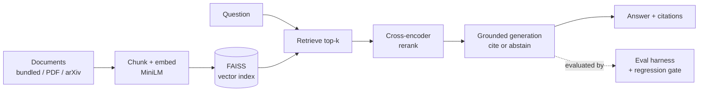

# grounded-rag

A retrieval-augmented QA system that cites its sources and declines to answer when the documents don't support it. It ships with an evaluation harness and a regression gate.

Live demo: https://grounded-rag-pushkar.streamlit.app · Built by [Pushkar Awate](https://pushkar-awate.github.io)

Ask questions over a bundled set of ML and LLM explainers, your own uploaded PDF, or a live arXiv search. Each answer is grounded in the passages that were retrieved and carries `[n]` citations back to the chunks it used. When the corpus does not contain the answer, the app says so rather than guessing. A one-click evaluation reports retrieval quality, groundedness, citation coverage, and the correct-refusal rate, and checks them against a committed baseline. The same check runs in CI.

## Why it is built this way

A lot of RAG demos will answer anything, including questions their corpus cannot support, and they rarely show whether an answer is actually backed by a source. This project treats an unsupported answer as a failure and measures that property directly.

- Abstention is tested, not assumed. The gold evaluation set includes questions the corpus cannot answer, and a system that answers them fails the `refusal_correct` judge.
- Retrieval runs in two stages. A fast bi-encoder (MiniLM with FAISS) pulls candidate chunks, then a cross-encoder reranker reads the question and each candidate together and reorders them. In practice this second stage is where most of the retrieval quality comes from.
- Every claim is cited back to the chunk it came from. Provenance is kept from ingestion through to the final answer.
- Evaluation is quantitative. Retrieval hit-rate, MRR, groundedness, citation coverage, and correct-refusal are aggregated into a scorecard with a pass or fail gate. An optional LLM judge adds a faithfulness check.
- Generation is provider-agnostic. The `Brain` interface switches between Groq for live answers and a deterministic offline answerer, so the tests and CI run with no API key and no cost.

## Architecture



Retrieve, rerank, generate with grounding, then evaluate. The app, the CLI, and the evaluation harness all run the same `RagPipeline`, so an evaluation number describes the same code path a user hits.

## Two tiers of evaluation

| Tier | Embedder / Reranker / Generator | Where it runs | Purpose |
|------|----------------------------------|---------------|---------|
| Deterministic | Hashing + identity + `ExtractiveBrain` | CI and committed `baseline.json` | Reproducible, offline, zero-cost guard on the logic |
| Live | MiniLM + cross-encoder + Groq Llama-3.3 | Streamlit Cloud | Real retrieval and generation quality |

CI never downloads a model or spends a token, but it still fails a pull request that breaks grounding or refusal. The live app runs the real stack. The gate tolerance covers the small differences between the two.

## Quickstart

```bash
pip install -r requirements.txt          # live stack
streamlit run streamlit_app.py           # open the app

# or just the evaluation (deterministic, no key, no downloads):
pip install -r requirements-dev.txt
python run.py                            # scorecard
python run.py --gate                     # fail on a regression vs the baseline
python run.py --llm                      # use Groq for generation and the faithfulness judge
```

Set `GROQ_API_KEY` (an environment variable or `.streamlit/secrets.toml`) to turn on LLM generation. Without it the deterministic extractive answerer runs, and the app still works from end to end.

## Results (committed baseline)

| Metric | Score |
|--------|------:|
| Retrieval hit-rate | 100% |
| MRR (mean) | 0.87 |
| Groundedness | 100% |
| Citation coverage | 100% |
| Correct refusal | 100% |

A 13-case gold set, 9 answerable and 4 unanswerable. Regenerate it with `python run.py --set-baseline`.

## Tech

Python, sentence-transformers (MiniLM), FAISS, cross-encoder reranking, Groq (Llama-3.3-70B), Streamlit, GitHub Actions. No paid services: local embeddings, a local vector index, a free LLM tier, and free hosting.

## Layout

```
ragcore/     ingest, embed, store, rerank, generate, pipeline, brain
evalcore/    dataset, judges, runner, metrics, gate
app/         corpus loaders (bundled / arXiv)
data/        sample corpus and gold eval set
tests/       deterministic pytest suite
run.py       eval CLI (scorecard / gate / baseline)
streamlit_app.py
```

Part of a set of reliability-focused AI/ML projects. See also [agenteval](https://github.com/pushkar-awate/agenteval) (evaluation and a regression gate for agents) and [selfheal-mlops](https://github.com/pushkar-awate/selfheal-mlops) (drift-triggered retraining).
